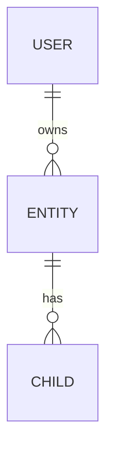

# {{PROJECT}} — Spec

> **One line:** {{what it is, for whom}}
> **Sources merged:** {{notes/*.md files and dates they were merged}}
> **Terms:** `GLOSSARY.md` · **Hard-to-reverse decisions:** `docs/adr/`

<!-- SPEC says WHAT and WHY. ROADMAP says in what order. Keep build status in the table below only, not as inline "(planned)" tags: one table is easy to keep true, scattered tags drift. Use the words defined in GLOSSARY.md; don't define terms here. No file paths or code snippets: they go stale. Exception: a snippet from a prototype that pins a decision more exactly than prose can (state machine, schema, type shape), trimmed to the decision and marked as coming from a prototype. -->

## Status
*Updated at each phase end.*

| § | Feature | Status | Phase |
|---|---|---|---|
| 2 | {{feature}} | Planned / Decided / Built / Parked | {{N}} |

## 1. Overview
- **Problem / pitch:** {{...}}
- **Users / players:** {{...}}
- **Pillars (what must stay true):** {{3–5 short principles used to settle design arguments}}
- **Non-goals:** {{...}}

## 2. Core loop / main flow
<!-- What the user does, over and over. A small diagram helps. -->

## 3. Data design *(optional)*
<!-- Only for projects with a database; delete this section otherwise. Design level, not DDL: each table's name, what one row is, and its fields with a plain type (text, number, date, bool, or → another table), whether required, and rules like "unique per user". Indexes, column types and migrations live in code. Mark decisions with a date like the feature sections. Update when a task changes the shape of the data. -->

**Core connections:**
<!-- Only the links that explain the data: users and the entities they own, and what those own in turn. Leave out lookup and join tables that add nothing to the picture. -->

### {{table}}
{{What one row is, who creates it, and when it is deleted.}}

| Field | Type | Notes |
|---|---|---|
| id | id | |
| {{field}} | text / number / date / bool / → {{table}} | {{required? unique? what it means}} |

## 4. {{Feature area}}
<!-- One section per area. Mark decisions with a date: "(decided YYYY-MM-DD)". -->

**Out of scope:** {{what this area deliberately won't do}}

**Testing:** {{the seam(s) that prove this area, preferably one high one; what a passing test shows (behavior, not internals); similar tests already in the codebase to copy}}

## N. Open questions
<!-- Each with the section it affects and what is blocked on it. Move answers into the relevant section and the ROADMAP decisions log. -->
- {{question}} — affects §{{N}}; blocks {{task}}
